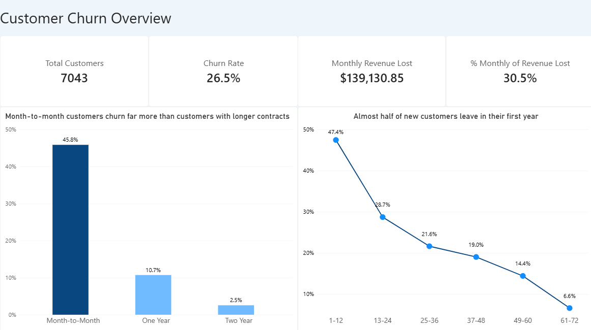
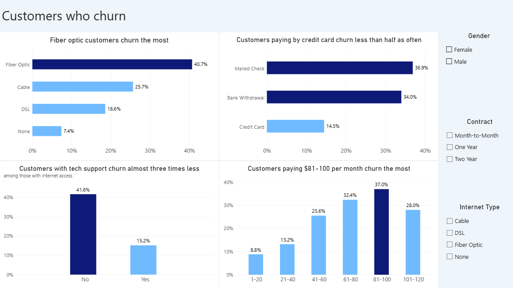
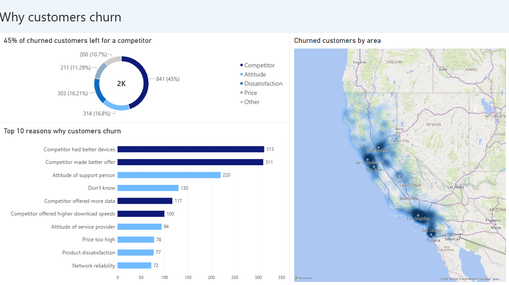
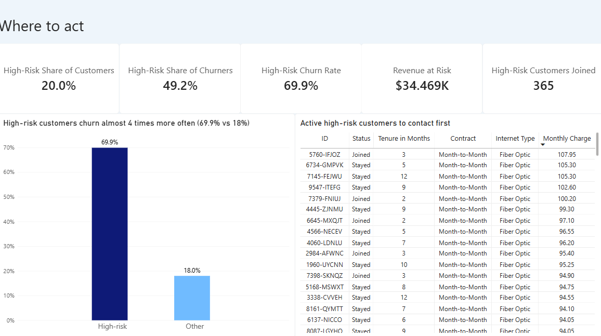

# Churn analysis of a telecom operator

End-to-end customer churn analysis for a telecom company: Excel - SQL (MySQL) - Power BI

A telecom operator loses 26.5% of its customers in a single quarter, and the customers who leave represent 30.5% of its monthly revenue. This project aims to find out why customers leave and what the company can do to keep more of them.

---

## Business problem

Each customer who leaves means lost revenue. The analysis is based on four main questions:

1. How big is the problem?
2. Who leaves?
3. Why do customers leave?
4. What can be done to prevent churn?

---

## Dataset

- Source: IBM Telco Customer Churn (11.1.3+), a fictional dataset published by IBM ([Kaggle](https://www.kaggle.com/datasets/alfathterry/telco-customer-churn-11-1-3))
- Contents: 7,043 customers of a telecom operator in California, in one quarter (Q3), with 50 columns: demographic data, location, services, contract, billing, status and reason for churn
- Currency: USD ($)

| Status | Customers | Share |
|---|---|---|
| Stayed | 4,720 | 67.0% |
| Churned | 1,869 | 26.5% |
| Joined (new customers this quarter) | 454 | 6.4% |

---

## Methodology

### 1. Excel: data exploration

- imported the data with Power Query (data types, regional settings) and checked for duplicates
- profiled each of the 50 columns (data type, distinct values, missing values, minimum, maximum) and documented a decision for each one (keep, remove or use only in the dashboard)
- ran 19 consistency checks, which all passed (for example, customers without internet service have no internet add-ons)
- Joined customers were treated as non-churn, but excluded when measuring risk, because they have not had the chance to leave yet
- built pivot tables and formulated the first hypotheses

### 2. SQL (MySQL): structure, validation and analysis

- imported the data into the table raw_telco, a raw copy of the file, with all columns stored as text
- normalized the data into 5 tables, linked by primary and foreign keys:

| Table | Contents |
|---|---|
| zip_codes | city, coordinates and population, one row per zip code |
| customers | demographic data and zip code |
| services | services and usage |
| accounts | contract, offer, payment method, tenure and billing amounts |
| churn_status | status, churn, scores, CLTV and reason for leaving |

- removed the columns Country, State and Quarter, because they have the same value for all customers
- loaded the data with the correct data types, converted empty values to NULL and validated the number of rows
- created the view vw_customer_analysis, with derived columns such as tenure groups, monthly charge groups, number of services and an existing customer indicator

### 3. Power BI: dashboard

- created a calculated column (High Risk Profile) and 17 DAX measures (churn rate, revenue lost, revenue at risk, high-risk profile indicators)
- built 4 pages, one for each business question: Overview, Who Leaves, Why They Leave and Where to Act

---

## Main findings

### 1. How big is the problem?

- 26.5% of customers churned in one quarter (28.4% of existing customers, without Joined)
- churned customers paid $139,131 per month out of the company's $456,116, which means 30.5% of monthly revenue, which tells us that customers who leave pay more than average

### 2. Who leaves?

- Contract is the strongest factor, since month-to-month customers churn 45.8%, compared to 10.7% for one-year and 2.5% for two-year contracts
- The highest-risk combination is a month-to-month contract with fiber optic internet, with 58.8% churn
- The first months are decisive, since 1 in 5 churned customers left in the first month, and half of them left within the first 10 months. In the first year churn is 47.4%, and after five years it drops to 6.6%
- Fiber optic customers churn the most (40.7%), compared to 25.7% for Cable and 18.6% for DSL
- Customers who pay by credit card churn 14.5%, compared to 34-37% for bank withdrawal and mailed check
- Among internet customers, those with premium tech support churn almost three times less (15.2% vs 41.6%)
- Churn decreases with every additional service, from 50.2% for customers with one add-on service to 4.9% for customers with all eight
- Churn increases with the monthly charge, from 8.8% for the cheapest plans to 37.0% for plans between $81 and $100
- Among cities with at least 30 customers, San Diego stands out with 64.9% churn (285 customers), followed by Fallbrook (60.5%) and Temecula (57.9%)

### 3. Why do customers leave?

- 45% of churned customers left for a competitor, which also accounts for 46.4% of the monthly revenue lost
- the top reasons are competitors' better devices and better offers, followed by the attitude of support staff
- fiber optic customers leave for competitors more often than others (47.5% of their churn vs 40.1%)
- customers who left for competitors paid the most per month, while customers who left because of price actually paid the least among churners
- price itself is a secondary reason (11.3% of churned customers)

### 4. Where should the company act?

High-risk profile: month-to-month contract, first year, no premium tech support.

| Indicator | Value |
|---|---|
| Share of existing customers | 20% |
| Share of all churned customers | 49% |
| Share of monthly revenue lost | 44% |
| Churn rate in the profile | 69.9% (vs 18% for other customers) |
| Monthly revenue still at risk (active customers in the profile) | $34,469 |
| New (Joined) customers who match the profile | 365 |

20% of customers cause almost half of all churn.

### Offer E

In the pivot tables, Offer E seemed to double churn (52.9%). The SQL analysis showed that Offer E is given only to new customers (average tenure of 3.7 months), who churn more by default. Comparing only first-year customers, Offer E has 52.9% churn vs 44.2% for other offers. While the offer does have an effect, it is smaller than it seemed at first, because it mostly comes from short tenure

---

## Hypotheses and results

The hypotheses were formulated in Excel, based on the pivot tables, and tested in SQL.

| Hypothesis | Result |
|---|---|
| H1: month-to-month contracts and short tenure increase churn | Confirmed: the strongest factors |
| H2: customers without tech support or online security churn more | Confirmed: almost three times more |
| H3: fiber optic customers churn more | Confirmed: 40.7% churn |
| H4: paying by bank withdrawal or mailed check is linked to higher churn | Confirmed: 34-37% vs 14.5% for credit card |
| H5: Offer E increases churn | Partly confirmed: the effect comes mostly from the short tenure of its customers |

---

## Recommendations

1. Using retention programs in the first months, focused on the first contact with support and the first bill, since 1 in 5 churned customers leaves in the first month. 
2. Encourage longer contracts for month-to-month customers. Research on telecom customers shows that contracts with a minimum duration help companies retain customers (Becker, Spann & Schulze, 2014), and that shortening the commitment period increases churn (Yang, de Matos & Ferreira, 2020).
3. Promote premium tech support and online security to internet customers. The data shows that churn decreases with every additional service, which is consistent with research that shows telecom services which come in bundles actively reduces churn (Prince & Greenstein, 2013).
4. Investigate competitors' offers for fiber optic customers (devices, speeds, offers).
5. Follow up as soon as possible with the 365 new customers who qualify for the high-risk profile. Although, since research shows that the customers with the highest risk are not always the ones who respond the best to retention campaigns (Ascarza, 2018), the campaign should be first tested on a smaller group.
6. Investigate the situation in San Diego, where almost two thirds of customers left.

---

## Limitations

- the dataset is fictional and covers a single quarter, and so trends over time cannot be analysed
- the segment analysis shows correlations, not necessarily causes (a factor can be linked to churn because of another factor, as seen with Offer E)
- a few zip codes have a very small population (10-30 people), probably non-residential areas; they were kept, because they do not affect the conclusions

## Next steps

- a logistic regression, in order to measure the effect of each factor while controlling for the others (for example, to confirm that Offer E's high churn is mostly explained by tenure)
- measuring customer satisfaction regularly, so it can become a usable risk indicator
- testing the recommendations with a pilot campaign by comparing a group that receives the offer with a control group

## References

- Ascarza, E. (2018). Retention futility: Targeting high-risk customers might be ineffective. Journal of Marketing Research, 55(1), 80-98.
- Becker, J., Spann, M., & Schulze, T. (2014). Implications of minimum contract durations on customer retention. Marketing Letters, 26. https://doi.org/10.1007/s11002-014-9293-2
- Prince, J., & Greenstein, S. (2013). Does service bundling reduce churn? Journal of Economics & Management Strategy, 23. https://doi.org/10.2139/ssrn.1966221
- Yang, B., de Matos, M. G., & Ferreira, P. (2020). The effect of shortening lock-in periods in telecommunication services. MIS Quarterly, 44(3), 1391-1409. https://doi.org/10.25300/MISQ/2020/14839

